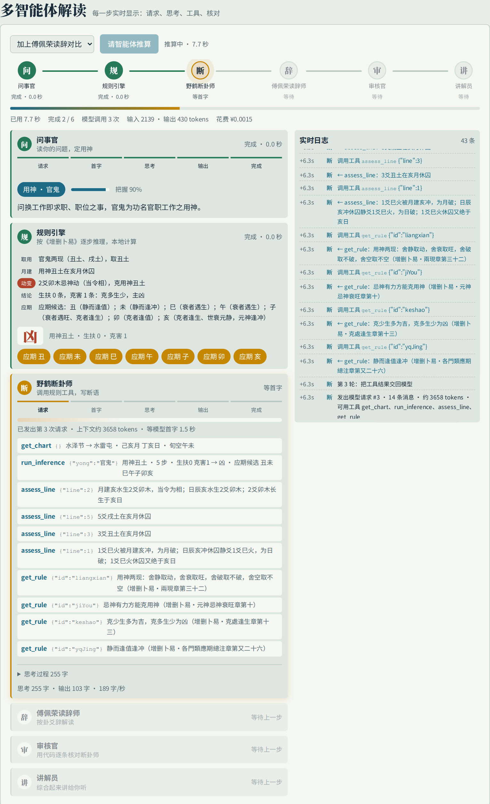
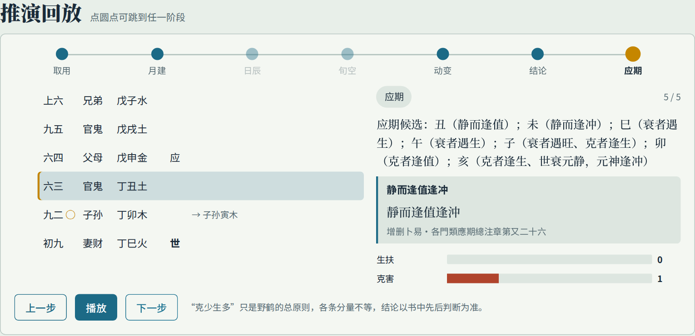
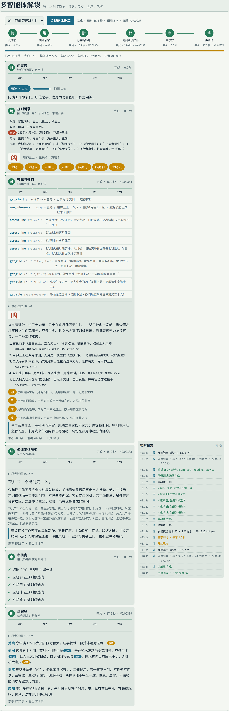
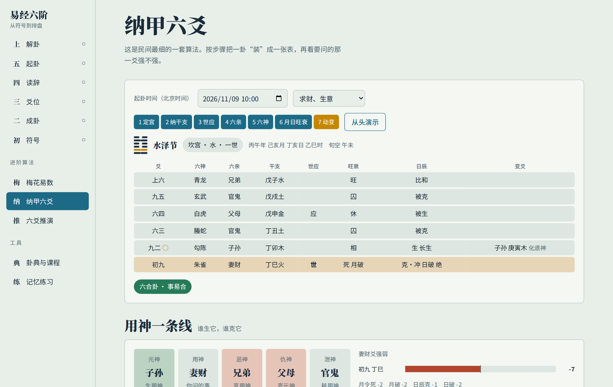
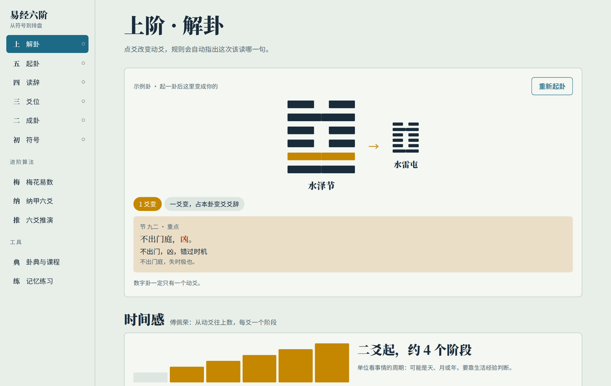
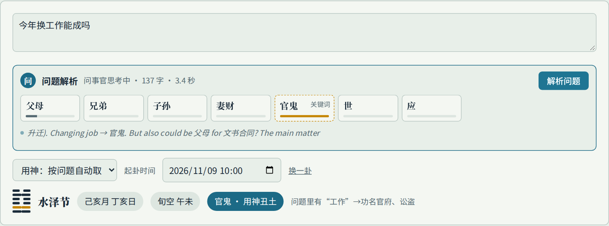
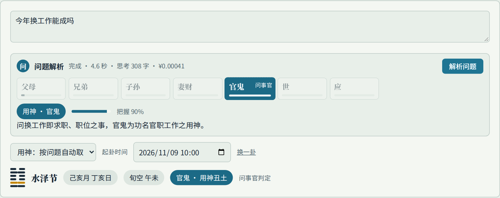
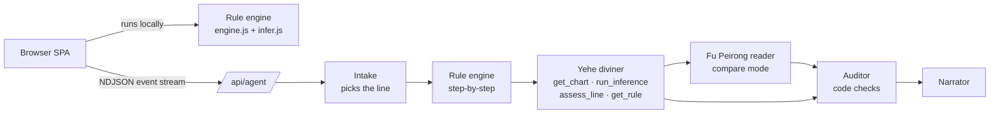

<div align="center">

# Yijing Study · 易经六阶

**Learn the I Ching from a single yin-yang line up to full Six-Line (六爻) divination. Classical rules run as code and every step cites its source; the LLM explains, it does not invent.**

English · [中文](README.md)




</div>

## Why

Ask a chatbot to "cast a hexagram for me" and it will confidently produce a chart. The stems and branches are often wrong, the rules get mixed up, the timing is made up, and you have no way to check any of it.

This project splits the work:

- **A rule engine does the chart and the reasoning.** Najia stems and branches, six relations, self/other lines, hidden lines, month and day influence, void branches, moving lines and timing (应期) follow *Zengshan Buyi* (增删卜易, 17th c.) and are implemented in code. Each step carries a rule id and the original quotation, and can be replayed one step at a time.
- **The LLM does what it is good at.** It works out what you are asking about, picks the relevant line, and explains the result in plain language. All chart data comes through tool calls; the model is not allowed to compute calendars or elements itself.
- **Everything the model says is audited.** The auditor is code, not another model. It checks that the verdict matches the engine, that each timing branch is among the engine's candidates, that cited rule ids exist, and that no branch absent from the chart is mentioned.

## Highlights

| | |
|---|---|
| 🧮 **Verifiable rules** | 594 chart checks against the open-source [najia](https://pypi.org/project/najia/) library with 0 differences; all 296 charts printed in *Zengshan Buyi* reproduced line by line |
| 📜 **Every step sourced** | ~40 rules, each with chapter and original text, shown as the replay advances |
| 🤖 **Multi-agent + tools** | Intake → rule engine → Yehe diviner → (Fu Peirong text reader) → auditor → narrator |
| 🎯 **Live question parsing** | Click "parse" and the intake agent starts picking the relevant line. Seven candidate bars rise and fall with the model's reasoning, lock when it answers, and the replay switches to that line; the full run reuses it |
| ⚡ **Fully live** | Pipeline progress, time to first token per request, streaming reasoning, every tool call with arguments and result, each audit check, live tokens and cost |
| 🔌 **Bring your own model** | Any OpenAI-compatible endpoint (DeepSeek, Qwen, GLM, local vLLM…) |
| 🎓 **Beginner friendly** | Six interactive levels — yin/yang, trigrams, line positions, reading the texts, casting, interpreting — plus Plum Blossom (梅花易数), Najia charting, a hexagram dictionary and drills |

## Screenshots

<table>
<tr>
<td width="50%"><br><sub><b>Step replay</b>: generating/overcoming arrows, rule card with source text, support vs. harm tally</sub></td>
<td width="50%"><br><sub><b>Multi-agent result</b>: reasons tagged with rules, audit ticks, narration marking (rule) vs (interpretation)</sub></td>
</tr>
<tr>
<td><br><sub><b>Najia chart</b>: built step by step, month/day branch ring, eight palaces</sub></td>
<td><br><sub><b>Reading</b>: toggle moving lines; Zhu Xi's rules pick which text to read</sub></td>
</tr>
<tr>
<td><br><sub><b>Question parsing</b>: click to start; candidate lines rise and fall with the model's reasoning</sub></td>
<td><br><sub><b>Parsed</b>: locked line, confidence and reason; the replay switches to it</sub></td>
</tr>
</table>

The UI is in Chinese.

## How faithful are the rules?

The measure is **agreement with the author's own judgments in the book**.

The engine runs on the 187 cases in *Zengshan Buyi* that give a full month and day, with 0 errors. Timing hits are reported separately for volume 1 (used while designing the rules) and volumes 2–4 (held out):

| | Hits | Mean candidate branches | Random guess, same count |
|---|---|---|---|
| Vol. 1 (used for design) | 8 / 9 | 4.4 | 43% |
| **Vols. 2–4 (held out)** | **29 / 50 = 58%** | 3.7 | 37% |

### Picking the relevant line: keyword table vs LLM

68 questions in `data/yong_eval.json` (rewritten from the book's chapter on the relevant line, original case questions, and modern colloquial ones), evaluated with deepseek-v4.1-flash:

| Method | Chapter | Book cases | Colloquial | Total |
|---|---|---|---|---|
| Keyword table | 75% | 90% | 70% | 75% |
| LLM given the keyword guess | 100% | 90% | 97% | 97% |
| **LLM on its own (current)** | 100% | 90% | 100% | **99%** |

The keyword guess misled the model, so the intake agent decides alone; the table serves as an offline first guess (`scripts/eval_yong.mjs`).

## Architecture



- `src/engine.js`: casting, changing-line rules, sexagenary calendar (lunar data 1900–2100), eight-palace Najia charts. Shared by browser and server.
- `src/infer.js`: the *Zengshan Buyi* rule engine. Each step records `{phase, text, rule, eff, lines, arrows}`, which drives the replay.
- `lib/agents.js`: agent orchestration and tools. `lib/llm.js`: OpenAI-compatible streaming client, cost accounting, optional budgets, mock model.
- `app/api/*`: `health`, `infer` (rules only, no LLM), `yong` (question parsing, event stream), `agent` (multi-agent, event stream).

## Quick start

Requires Node 22+ and Python 3 (the build script inlines the single page).

```bash
git clone https://github.com/JYao-Chen/yijing-study.git
cd yijing-study
npm install
npm run build
cp .env.example .env.local   # set LLM_BASE_URL / LLM_API_KEY / LLM_MODEL
npm start                    # http://127.0.0.1:18500
```

The learning levels, charts and replay run in the browser without a model; the multi-agent panel needs one. Set `LLM_MOCK=1` to run the whole pipeline on a mock model.

| Variable | Meaning |
|---|---|
| `LLM_BASE_URL` `LLM_API_KEY` `LLM_MODEL` | OpenAI-compatible endpoint; all three enable the agents |
| `LLM_PRICE_IN` `LLM_PRICE_OUT` | Price per million tokens (CNY) for live cost display |
| `LLM_DAILY_BUDGET_YUAN` `LLM_RUN_BUDGET_YUAN` | Optional spend caps; unset means unlimited |
| `LLM_RUN_MAX_CALLS` | Optional cap on model calls per run; unset means unlimited |
| `LLM_JSON_MODE` | Set `0` if the endpoint lacks `response_format` |

Nothing is capped by default: no `max_tokens` (reasoning tokens count toward output), no limit on tool rounds, calls, spend or request time. Use the variables above to add caps.

## Tests

`bash scripts/verify.sh` installs, builds, runs the API tests, engine and classical cross-checks, and Playwright smoke tests (requires `uv`). See the table in the [Chinese README](README.md#测试).

## Sources

- Classical texts: Chinese Wikisource — *Zhouyi*, *Zengshan Buyi*, *Huangjin Ce*, *Huozhu Lin* (public domain; see `corpus/SOURCE.md`).
- Changing-line rules: Zhu Xi, *Yixue Qimeng*; Plum Blossom: Shao Yong.
- Fu Peirong's I Ching lectures: only original summaries and links are included; no lecture text is in this repository.
- Cross-check: [najia](https://pypi.org/project/najia/) (MIT).

## Roadmap

- [ ] Three-harmony frames, weather chapter, more timing rules
- [ ] More schools (*Huangjin Ce*, *Bushi Zhengzong*) and cross-school comparison
- [ ] A public benchmark of classical cases for LLM divination
- [ ] Logging readings and back-filling outcomes

## Disclaimer

For learning about traditional culture and studying how rule systems and LLMs can work together. Nothing here is medical, legal, financial or life advice.

## License

Code: MIT. Classical texts: public domain.
