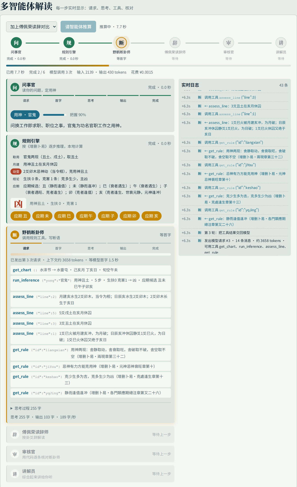
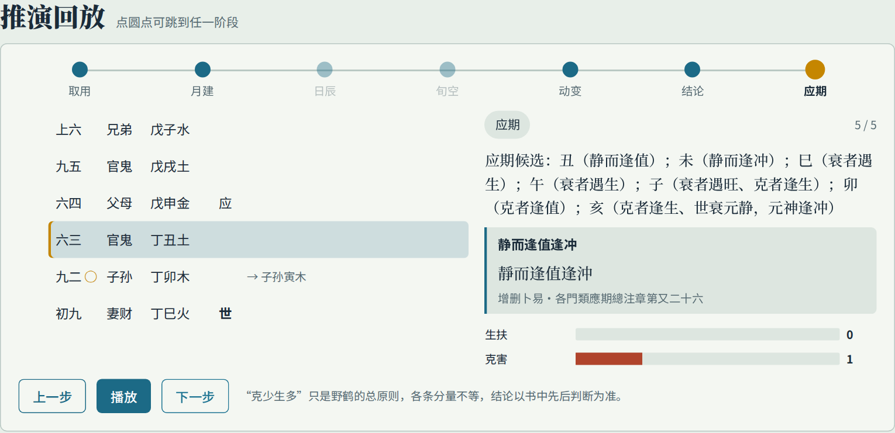
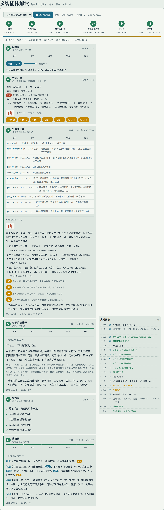
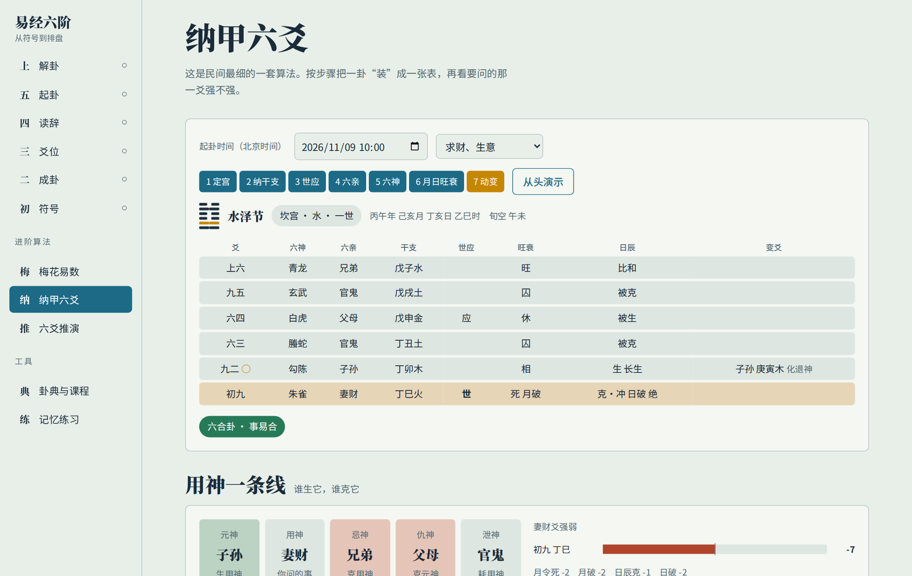
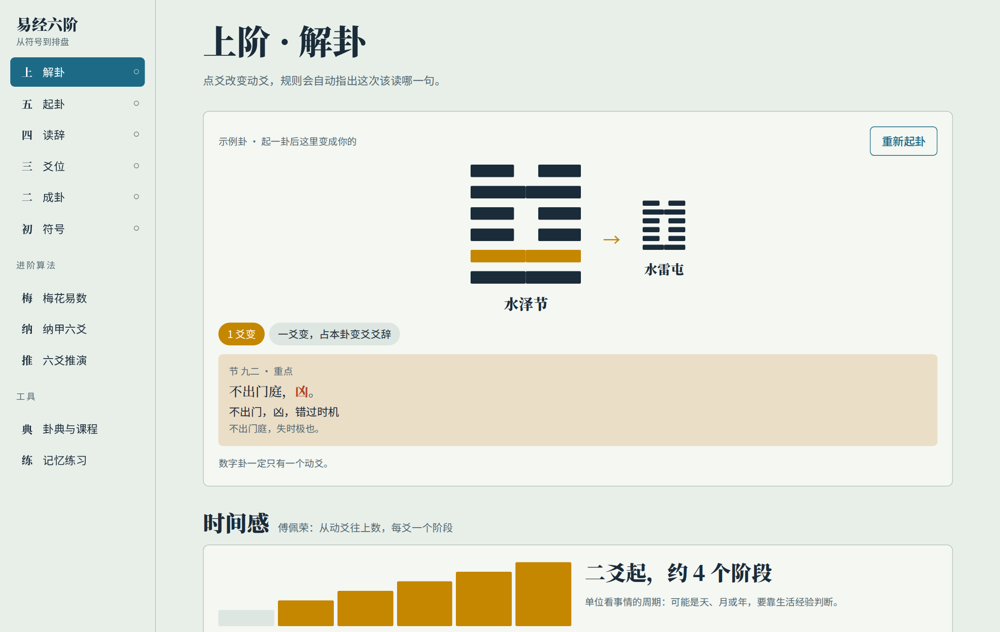
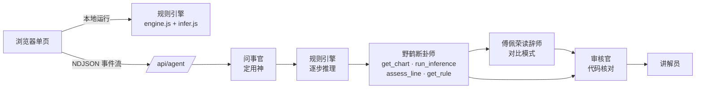

<div align="center">

# 易经六阶 · Yijing Study

**从一根阴阳爻学到六爻推演：古籍规则由代码执行、逐条可查，大模型只负责讲解，不负责编造。**

[English](README.en.md) · 中文




</div>

## 为什么做这个

问大模型“帮我算一卦”，它会很笃定地给你一张排盘，可干支常算错、月破日破张冠李戴、应期随口一说，你也无从核对。

这个项目把事情分开做：

- **排盘与推理交给规则引擎。** 纳甲、六亲、世应、伏神、月建日辰、旬空、动变、应期，全部按野鹤老人《增删卜易》写成代码。每一步都带规则编号和古籍原文，可以一步步回放。
- **模型只做它擅长的事。** 读懂你问的是什么事、取哪一爻为用神，再把规则结论讲成人话。模型要的数据都得调用工具取得，不允许自己推算历法。
- **说的每句话都有人核对。** 审核官是一段代码，不是模型。它逐条检查断卦师：结论是否和规则引擎一致、应期在不在候选里、引用的规则存不存在、有没有提到排盘里根本没有的地支。

## 亮点

| | |
|---|---|
| 🧮 **规则可验证** | 排盘与开源库 [najia](https://pypi.org/project/najia/) 交叉核对 594 项，0 差异；《增删卜易》书中 296 个卦逐爻核对，全部一致 |
| 📜 **步步有出处** | 约 40 条规则，每条附章节与原文，推演时随步骤展示 |
| 🤖 **多智能体 + 工具调用** | 问事官 → 规则引擎 → 野鹤断卦师 →（傅佩荣读辞师）→ 审核官 → 讲解员 |
| 🎯 **问题解析实时可见** | 写好问题点“解析问题”，问事官开始取用神：七个候选的权重随模型思考实时起落，一给出用神就锁定，回放随即改用它；推算时直接沿用，不再等第二遍 |
| ⚡ **全程实时可见** | 流水线进度、每次请求的首字耗时、逐字的思考过程、每次工具调用的参数与返回、每条审核结果、实时 token 与花费 |
| 🔌 **自带模型** | 任意 OpenAI 兼容接口（DeepSeek、通义、GLM、本地 vLLM…） |
| 🎓 **零基础也能学** | 六个阶段从阴阳、八卦、爻位、读辞、起卦到解卦，配大量交互图形和动画，另有梅花易数、纳甲六爻、卦典与记忆练习 |

## 看看效果

<table>
<tr>
<td width="50%"><br><sub><b>推演回放</b>：一步步播放规则推理，生克箭头、规则原文、生扶与克害计数</sub></td>
<td width="50%"><br><sub><b>多智能体结果</b>：断卦理由附规则名，审核逐条打勾，讲解员标注（规则）与（解读）</sub></td>
</tr>
<tr>
<td><br><sub><b>纳甲六爻</b>：按步骤装卦，月建日辰地支环，八宫图</sub></td>
<td><br><sub><b>解卦</b>：点爻改变动爻，按朱熹变爻规则自动指出该读哪一句</sub></td>
</tr>
<tr>
<td><br><sub><b>问题解析</b>：点按钮开始，候选用神随问事官的思考实时起落</sub></td>
<td><br><sub><b>解析完成</b>：锁定用神、给出把握与理由，回放随即改用</sub></td>
</tr>
</table>

## 规则准不准？

衡量标准是**与野鹤本人断法的一致程度**。

规则引擎在《增删卜易》187 个有完整月日的卦例上运行，0 报错。应期按“卷一用来设计规则、卷二至四留作检验”分开统计：

| | 命中 | 平均候选地支数 | 同样数量随机猜 |
|---|---|---|---|
| 卷一（设计规则时参照） | 8 / 9 | 4.4 | 43% |
| **卷二至四（留出检验）** | **29 / 50 = 58%** | 3.7 | 37% |

### 取用神：关键词表 vs 大模型

取错用神，后面推得再对也没用。`data/yong_eval.json` 收了 68 题：A 组按《用神章》改写的问句，B 组书中卦例的原问，C 组现代口语（“女朋友要读博还是工作”“考公能上岸吗”）。评测模型 deepseek-v4.1-flash：

| 方法 | A 用神章 | B 书中卦例 | C 现代口语 | 合计 |
|---|---|---|---|---|
| 关键词表 | 75% | 90% | 70% | 75% |
| 模型，附关键词结果作提示 | 100% | 90% | 97% | 97% |
| **模型独立判断（现行）** | 100% | 90% | 100% | **99%** |

关键词表栽在字面上：“房子”的“子”命中子孙，“朋友欠钱”命中兄弟。把关键词结果给模型当提示反而会带偏它，所以问事官独立判断，关键词表用于没有模型时的离线初判和事后对照。脚本见 `scripts/eval_yong.mjs`。

## 架构



- `src/engine.js`：起卦、变爻读法、干支历法（1900–2100 农历）、八宫纳甲排盘，浏览器与服务端共用。
- `src/infer.js`：野鹤规则推理，每一步记录 `{phase, text, rule, eff, lines, arrows}`，前端据此画回放。
- `lib/agents.js`：多智能体编排与工具；`lib/llm.js`：OpenAI 兼容流式调用、记账、可选限额、假模型。
- `app/api/*`：`health`、`infer`（纯规则，不调模型）、`yong`（问题解析，事件流）、`agent`（多智能体，事件流）。

## 快速开始

需要 Node 22+ 与 Python 3（构建脚本用来内联单页）。

```bash
git clone https://github.com/JYao-Chen/yijing-study.git
cd yijing-study
npm install
npm run build
cp .env.example .env.local   # 填 LLM_BASE_URL / LLM_API_KEY / LLM_MODEL
npm start                    # http://127.0.0.1:18500
```

学习六阶、梅花、纳甲、六爻推演回放都在浏览器本地运行，不需要模型；多智能体解读需要模型。设 `LLM_MOCK=1` 使用假模型跑通全流程。

### 模型配置

| 变量 | 说明 |
|---|---|
| `LLM_BASE_URL` `LLM_API_KEY` `LLM_MODEL` | OpenAI 兼容接口，三项齐全即启用 |
| `LLM_PRICE_IN` `LLM_PRICE_OUT` | 元 / 百万 token，用于实时显示花费 |
| `LLM_DAILY_BUDGET_YUAN` `LLM_RUN_BUDGET_YUAN` | 每日 / 每次花费上限，不设为不限（默认不限） |
| `LLM_RUN_MAX_CALLS` | 每次推算最多调用次数，不设为不限 |
| `LLM_JSON_MODE` | 接口不支持 `response_format` 时设为 `0` |
| `LLM_USAGE_LOG` | 用量记录（默认 `~/.local/state/yijing-study/usage.jsonl`），不记录密钥 |

默认不设任何限制：不设 `max_tokens`（推理型模型的思考也计入输出），不限工具调用轮数、调用次数、花费和请求时长。需要时用上面的变量自行加上限。

## 测试

```bash
bash scripts/verify.sh   # 安装、构建、接口测试、引擎与古籍对照、浏览器冒烟，需要 uv
```

| 测试 | 内容 |
|---|---|
| `tests/api.test.mjs` | 接口与事件流顺序（假模型） |
| `tests/compare_najia.py` | 64 卦纳甲、六亲、世应、伏神，10 日干六神，200 组随机变爻，与 najia 对照 |
| `tests/test_zsby_cases.py` | 《增删卜易》296 个卦逐爻核对排盘 |
| `tests/test_infer.py` | 推理对照书中用神与应期，分卷统计 |
| `tests/test_engine.py` | 古籍例题、lunar_python 历法交叉校验 |
| `tests/smoke.py` `tests/smoke_live.py` | Playwright 全视图冒烟、问题解析与多智能体实时面板 |
| `scripts/eval_yong.mjs` | 取用神评测（需配置模型） |

## 资料来源

- 经文与规则原文：维基文库《周易》《增删卜易》《黄金策》《火珠林》（公有领域，见 `corpus/SOURCE.md`）。
- 变爻读法：朱熹《易学启蒙·考变占》；梅花易数：邵雍起例。
- 傅佩荣《易经》课程：页面只放自撰的要点摘要与原链接，讲稿原文不在仓库中。
- 开源对照：[najia](https://pypi.org/project/najia/)（MIT）。

## 路线图

- [ ] 三合局、天时章、更多应期规则
- [ ] 更多流派：《黄金策》《卜筮正宗》，流派之间对比
- [ ] 公开评测集：把古籍卦例整理成 LLM 断卦的基准
- [ ] 断卦记录与事后回填结果

## 声明

本项目用于学习传统文化和研究规则系统与大模型的协作方式。推演结果不构成任何医疗、法律、投资或人生决策建议。

## 许可

代码 MIT。古籍文本为公有领域。
